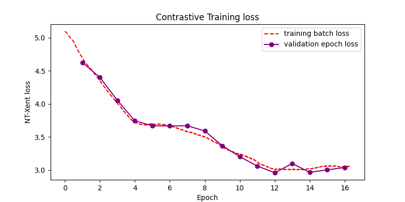
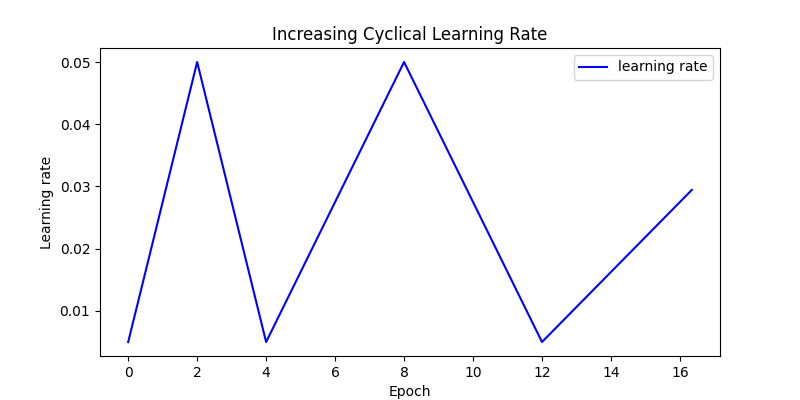
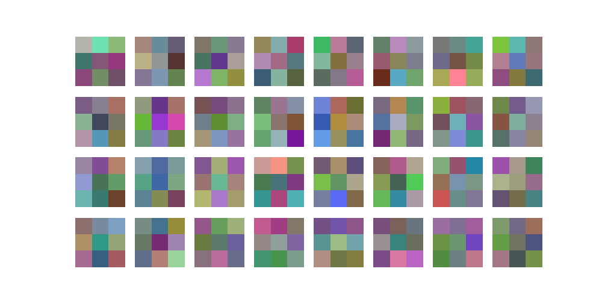
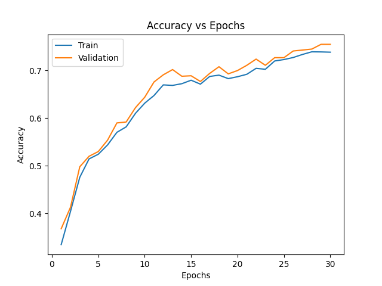
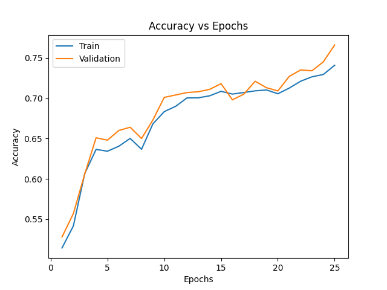
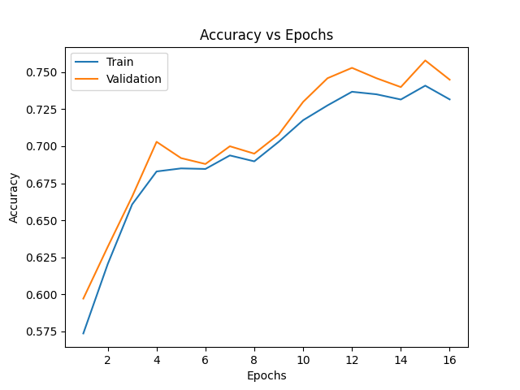

# Time Efficiency of CNN Representation Learning Paradigms

This repository investigates the computational and time trade-offs between **Self-Supervised Contrastive Pre-training (SimCLR)** followed by fine-tuning versus standard **End-to-End Supervised Learning** under fixed training budgets.

> **Note on Dataset:** While earlier experiments were conceptualized around more complex datasets, all presented experiments, evaluations, and figures are conducted on the **CIFAR-10** dataset (32×32 RGB images) to lessen compute needed and speed up training.

---

## Model Architecture

The network consists of a 6-layer convolutional backbone divided into three 2-layer blocks, followed by a 2-layer multi-layer perceptron (MLP) classification head:

* **Backbone:** 6 stacked convolutional layers structured in pairs, separated by 2×2 max-pooling operations.
* **Activation:** ReLU for all hidden layers; unnormalized linear output for class logits.
* **Regularization & Optimization:** AdamW optimizer, L2 weight decay (2.5 × 10⁻⁴), cyclical learning rate scheduling, and data augmentations (mirroring, color jitter, Gaussian noise, and crop-and-scale).

---

## Training Regimes Compared

We evaluate three distinct workflows across comparable wall-clock training horizons:

1. **Pure Supervised Learning:** Trained end-to-end for 30 epochs with dropout (p = 0.5, initial pool p = 0.3) and learning rates between 10⁻⁴ and 10⁻³.
2. **Light Contrastive Pre-training:** 6 epochs of SimCLR pre-training (NT-Xent loss, learning rate 5 × 10⁻³ to 5 × 10⁻², no dropout) followed by 25 epochs of supervised fine-tuning.
3. **Substantial Contrastive Pre-training:** 16 epochs of SimCLR pre-training followed by 16 epochs of supervised fine-tuning.

---

## Visualizing Pre-Training & Learned Features

### Contrastive Pre-Training Dynamics
SimCLR utilizes an increasing cyclical learning rate to propagate gradients to initial convolutional filters, steadily decreasing the NT-Xent validation loss:

| Contrastive Loss (16 Epochs) | Cyclical Learning Rate Schedule |
| :---: | :---: |
|  |  |

### Learned Conv 1 Filter Representations
Contrastive pre-training forces early layers to organize into distinct, interpretable edge and color detectors, whereas purely supervised filters remain significantly more dispersed:

| Contrastive Pre-Trained Filters | Pure Supervised Filters |
| :---: | :---: |
|  |  |

---

## Results on CIFAR-10

| Training Paradigm | Pre-train Epochs | Fine-Tune Epochs | Test Accuracy |
| :--- | :---: | :---: | :---: |
| **Fully Supervised** | 0 | 30 | **73.7%** |
| **Light Pre-training** | 6 | 25 | 72.4% |
| **Substantial Pre-training** | 16 | 16 | 72.0% |

### Accuracy Curves Across Regimes

| Full Supervised | Light Pre-Training | Substantial Pre-Training |
| :---: | :---: | :---: |
|  |  |  |

---

## Key Insights

* **Time-to-Accuracy Efficiency:** When total training compute is limited, standard end-to-end supervised learning achieves higher peak accuracy faster than allocating compute to contrastive pre-training from scratch.
* **Filter Formation vs. Task Performance:** Although contrastive pre-training reliably produces well-formed Gabor-like edge and color filters, the supervised network achieves equal or better downstream classification even with unstructured filters, exhibiting properties similar to echo-state/reservoir networks.
* **Overhead Trade-off:** Unless pre-trained representations are amortized across several distinct downstream tasks, training representations via self-supervised contrastive learning from scratch on small-scale domains is not justified on pure time efficiency grounds.

---

## Citation & Authors

* **Authors:** Oliver Bielke & Simon Stoll
* **Course/Affiliation:** KTH Royal Institute of Technology (EECS)
